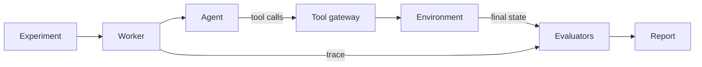

# AI Agent Eval

Runs an AI agent many times inside controlled environments, grades the resulting state, and compares configurations task by task.

Status: one complete path works end to end. A scripted agent handles a refund task in the mock retail store, every tool call is traced, and the result is graded from the store's final state. Accounts, real model agents, the job queue and the web pages come next.

## How a run flows



Every agent changes state only through the tool gateway. Evaluators read the hidden expected state, which the agent never sees.

## What happens in one attempt

1. The runner creates fresh state for the task's environment from the task's hidden fixture, and saves an initial snapshot.
2. The agent gets only the agent-visible part of the task: the customer's message and who is signed in.
3. Every tool call goes through the gateway. It checks the tool is allowed, validates the arguments strictly, takes the customer's identity from the server (never from the agent), runs the tool, and records the call and its effect in the trace.
4. When the agent stops, the runner saves a final snapshot and removes the live state.
5. Evaluators compare the final state with what the task expects. Each failure names a reason code and points at the trace events that caused it.

A run passes only if every applicable check passes and the agent did not hit a hard limit (turns, tool calls or time).

## Trace events

| Event | When |
| --- | --- |
| `attempt_started` | The agent gets its input. Holds what the agent saw, its tools and its limits |
| `tool_call_requested` | The agent asked for a tool. Recorded before anything runs |
| `tool_call_completed` | The gateway answered. Holds the outcome and any state change |
| `agent_finished` | The agent stopped. Holds the final message and why it stopped |

## Grading

| Evaluator | Dimension | Reason codes |
| --- | --- | --- |
| `refund_outcome` 1.0.0 | `refund_amount` | `MISSING_REFUND`, `WRONG_REFUND_AMOUNT`, `DUPLICATE_REFUND` |
| `refund_outcome` 1.0.0 | `unexpected_refunds` | `UNEXPECTED_REFUND` |

If an evaluator crashes, its score is `evaluation_error`. That never counts as a pass or as an agent failure.

## Environments

| Environment | Tools | Rules enforced today |
| --- | --- | --- |
| `support-retail@1` | `get_order`, `issue_refund` | A customer only sees and refunds their own orders. Refunds cannot exceed what is left on the order |

Money in the retail store is in minor units (cents), stored as integers.

## Quick start

You need Docker and [uv](https://docs.astral.sh/uv/).

```bash
cp .env.example .env
make up
curl http://127.0.0.1:8000/health/ready
```

`make up` starts Postgres, runs migrations, then starts the API and the worker.

To see the end-to-end refund path run, use `make test`. The tests run a correct script and a script that refunds the wrong amount, and check that the second one fails with `WRONG_REFUND_AMOUNT` pointing at the refund call.

Demo mode with scripted agents and no provider key is not built yet.

## Make commands

| Command | What it does |
| --- | --- |
| `make up` | Build and start the stack, wait until healthy |
| `make down` | Stop the stack |
| `make logs` | Follow logs from every service |
| `make ps` | Show service status |
| `make migrate` | Run database migrations |
| `make db` | Start only Postgres, for running tests on the host |
| `make test` | Start Postgres, migrate, run the tests |
| `make lint` | Check lint and formatting |
| `make format` | Fix formatting and safe lint issues |
| `make typecheck` | Run mypy in strict mode on `app/` |
| `make check` | Lint, typecheck and test |

## Folders

| Folder | What it holds |
| --- | --- |
| `app/agents/` | The agent contract and the scripted agent |
| `app/api/` | HTTP routes, including health checks |
| `app/db/` | Tables, datasets, experiments and schema checks |
| `app/environments/` | The environment contract, its state store and the retail store |
| `app/evaluators/` | The evaluator contract and the checks that grade runs |
| `app/execution/` | The attempt runner, the trace recorder and the worker |
| `app/gateway/` | The tool gateway every agent calls |
| `datasets/` | Tasks, one JSON file each |
| `migrations/` | Alembic migrations |
| `tests/` | Tests, laid out like `app/` |

## Settings

All settings are in `.env.example`. The main ones:

| Setting | Default | Meaning |
| --- | --- | --- |
| `DATABASE_URL` | local Postgres | Database for running outside Docker. Compose sets its own |
| `API_PORT` | `8000` | Host port for the API |
| `POSTGRES_PORT` | `5432` | Host port for Postgres |
| `LOG_LEVEL` | `INFO` | `DEBUG`, `INFO`, `WARNING` or `ERROR` |
| `LOG_FORMAT` | `json` | `json` or `text` |

## Connect your own agent

Not built yet. External agents will connect over HTTP and call the tool gateway with a short-lived run token. A minimal example agent will live in `examples/`.

## License

No license has been chosen yet. Until then, all rights are reserved.
