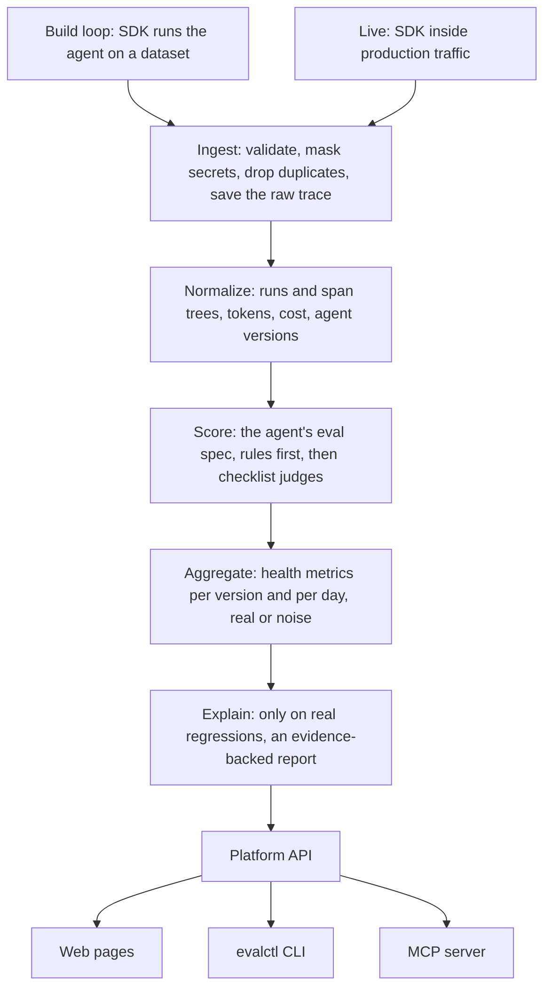

# AI Agent Eval

A platform for measuring how well an AI agent works, while you build it and after it goes live. It grades every run from the agent's own trace, tracks results per agent version, and explains why a new version got worse.

Status: being rebuilt around traces. Today it has accounts and workspaces, API tokens, encrypted provider keys, prices and budgets, a Postgres job queue with leases, and a metered Gemini provider. Trace ingest, scoring, judges, metrics, the regression explainer, the SDK and the full web pages come next.

## How it works

Every trace will take the same path, from a test run or from production. The stages from ingest onwards are being built.



What exists today:

| Part | What it does |
| --- | --- |
| Workspaces | Every row carries its workspace and every query is filtered by it. A row in another workspace answers exactly like a missing one (`404`) |
| Accounts | Email and password sign-in with HTTP-only cookies and CSRF checks, roles (`viewer`, `member`, `owner`), invites, revocable API tokens shown once |
| Provider keys | Stored encrypted with AES-GCM under `APP_MASTER_KEY`. Only a label and the last four characters are ever shown |
| Prices and budgets | Prices per model in micro-units. Budgets cap money, tokens and requests; every model call reserves its worst case first, so two workers can never both spend the last of a budget |
| Job queue | Postgres with `FOR UPDATE SKIP LOCKED`. Each job holds a lease renewed by a heartbeat. A crashed worker's job is retried by another, and a worker that lost its lease cannot write a result or spend budget |
| Gemini provider | Model calls with retries, a shared rate limit per key, and a spend record for every try |

## Run it locally

You need Docker and [uv](https://docs.astral.sh/uv/).

```bash
cp .env.example .env
make up
curl http://127.0.0.1:8000/health/ready
```

`make up` starts Postgres, runs migrations, then starts the API and the worker. To store provider keys, first set `APP_MASTER_KEY` in `.env`; the comment above it shows how to make one.

On a fresh install, create the first account. That person becomes the owner of the first workspace. This works only once.

```bash
curl -X POST http://127.0.0.1:8000/api/v1/auth/setup -H 'content-type: application/json' -d '{"email": "you@example.com", "password": "at least twelve characters", "workspace_name": "My team"}'
```

Then open http://127.0.0.1:8000 and sign in to manage members, API tokens and provider keys.

A demo with seeded data that needs no key is not built yet.

## Connect an agent

Agents will send their traces through a Python SDK, which is not built yet.

## Make commands

| Command | What it does |
| --- | --- |
| `make up` | Build and start the stack, wait until healthy |
| `make down` | Stop the stack |
| `make logs` | Follow logs from every service |
| `make ps` | Show service status |
| `make migrate` | Run database migrations |
| `make db` | Start only Postgres, for running tests on the host |
| `make test` | Start Postgres, migrate, run the tests. Needs no network or key |
| `make test-paid` | Run the test that calls the real Gemini API. Needs `GEMINI_API_KEY` |
| `make lint` | Check lint and formatting |
| `make format` | Fix formatting and safe lint issues |
| `make typecheck` | Run mypy in strict mode on `app/` |
| `make check` | Lint, typecheck and test |

## Folders

| Folder | What it holds |
| --- | --- |
| `app/api/` | HTTP routes |
| `app/auth/` | Accounts, passwords, sessions, invites and API tokens |
| `app/budget/` | Prices, worst-case estimates, reservations, warnings and pausing |
| `app/db/` | Tables, the workspace-scoped data layer, the job queue, audit log |
| `app/execution/` | The worker and its lease heartbeat |
| `app/providers/` | The Gemini provider, encrypted keys, rate limiting, metered calls |
| `app/reports/` | Scorecard and comparison maths |
| `app/web/` | The web pages, their templates and static files |
| `migrations/` | Alembic migrations |
| `tests/` | Tests, laid out like `app/` |

## Settings

All settings are in `.env.example`. The main ones:

| Setting | Default | Meaning |
| --- | --- | --- |
| `DATABASE_URL` | local Postgres | Database for running outside Docker. Compose sets its own |
| `API_PORT` | `8000` | Host port for the API |
| `POSTGRES_PORT` | `5432` | Host port for Postgres |
| `LOG_LEVEL` | `INFO` | `DEBUG`, `INFO`, `WARNING` or `ERROR` |
| `LOG_FORMAT` | `json` | `json` or `text` |
| `SESSION_TTL_HOURS` | `12` | How long a sign-in lasts |
| `SESSION_COOKIE_SECURE` | `false` | Send the session cookie over HTTPS only. Turn on anywhere but a laptop |
| `INVITE_TTL_HOURS` | `72` | How long an invite stays valid |
| `APP_MASTER_KEY` | none | Encrypts stored provider keys. Base64 of 32 random bytes. Needed to store or use a key |
| `MODEL_CALL_TIMEOUT_SECONDS` | `60` | How long one model request may take |
| `MODEL_CALL_MAX_RETRIES` | `4` | Retries for rate-limited or failed model requests |
| `WORKER_CONCURRENCY` | `2` | Jobs one worker runs at once |
| `LEASE_SECONDS` | `30` | How long a job's lease lasts without a heartbeat |
| `HEARTBEAT_SECONDS` | `10` | How often a worker renews its leases. At most half of `LEASE_SECONDS` |
| `RECONCILE_SECONDS` | `15` | How often a worker looks for expired leases |
| `MAX_JOB_ATTEMPTS` | `3` | Times a job may be interrupted before it is marked failed |

## License

No license has been chosen yet. Until then, all rights are reserved.
