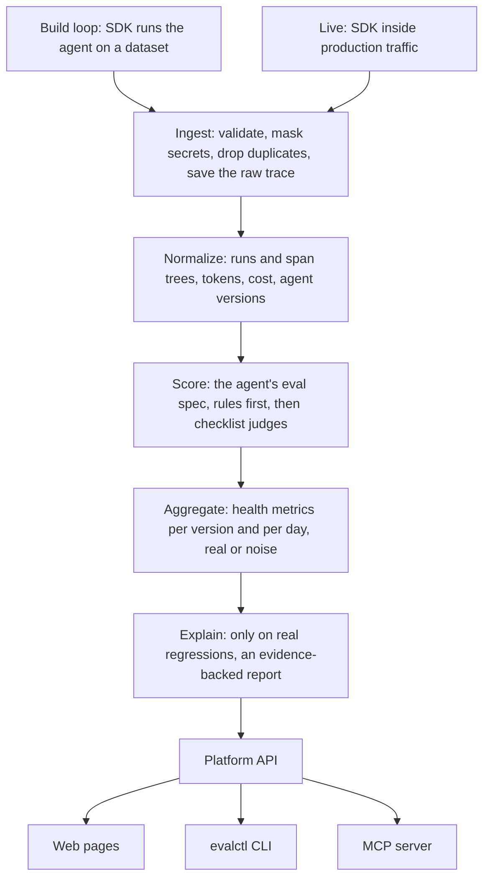

# AI Agent Eval

A platform for measuring how well an AI agent works, while you build it and after it goes live. It grades every run from the agent's own trace, tracks results per agent version, and explains why a new version got worse.

Status: being rebuilt around traces. Today it takes traces in, from the Python SDK or straight over the API, and turns them into runs, span trees, costs and agent versions. It also has accounts and workspaces, API tokens, encrypted provider keys, prices and budgets, a Postgres job queue with leases, and a metered Gemini provider. Scoring, judges, metrics, the regression explainer and the full web pages come next.

## How it works

Every trace takes the same path, from a test run or from production. Ingest and normalize work today; the stages after them are being built.



What exists today:

| Part | What it does |
| --- | --- |
| Trace ingest | `POST /api/v1/traces` takes up to 100 traces. Secrets are masked first, then each trace is checked, stored raw, and turned into a run with its span tree, tokens, cost and agent version. A trace sent twice is stored once. Each workspace has a per-minute limit; over it, the answer is `429` with `Retry-After` |
| Feedback | `POST /api/v1/feedback` records a user's rating of a trace from the team's own product: a score from 0 (thumbs down) to 1 (thumbs up) and an optional comment, masked like traces. The sender picks the `feedback_id`, so a retried send is stored once. It may arrive before its trace |
| Datasets | Versioned cases: an input, an optional expected outcome, tags and notes. `POST /api/v1/datasets` stores a new version; uploading the same cases again reuses the newest one. Case keys stay the same across versions, so results can be paired by case |
| Experiments | One agent version run on one dataset version, each case a set number of times. `POST /api/v1/experiments` returns the cases to run; an `Idempotency-Key` header makes a retried start return the same experiment. Each run's trace names its slot with tags, and a trace that does not fit its slot is rejected |
| Workspaces | Every row carries its workspace and every query is filtered by it. A row in another workspace answers exactly like a missing one (`404`) |
| Accounts | Email and password sign-in with HTTP-only cookies and CSRF checks, roles (`viewer`, `member`, `owner`), invites, revocable API tokens shown once |
| Provider keys | Stored encrypted with AES-GCM under `APP_MASTER_KEY`. Only a label and the last four characters are ever shown |
| Prices and budgets | Prices per model in micro-units. Budgets cap money, tokens and requests; every model call reserves its worst case first, so two workers can never both spend the last of a budget |
| Job queue | Postgres with `FOR UPDATE SKIP LOCKED`. Each job holds a lease renewed by a heartbeat. A crashed worker's job is retried by another, and a worker that lost its lease cannot write a result or spend budget |
| Gemini provider | Model calls with retries, a shared rate limit per key, and a spend record for every try |

## Run it locally

You need Docker and [uv](https://docs.astral.sh/uv/).

```bash
cp .env.example .env
make up
curl http://127.0.0.1:8000/health/ready
```

`make up` starts Postgres, runs migrations, then starts the API and the worker. To store provider keys, first set `APP_MASTER_KEY` in `.env`; the comment above it shows how to make one.

On a fresh install, create the first account. That person becomes the owner of the first workspace. This works only once.

```bash
curl -X POST http://127.0.0.1:8000/api/v1/auth/setup -H 'content-type: application/json' -d '{"email": "you@example.com", "password": "at least twelve characters", "workspace_name": "My team"}'
```

Then open http://127.0.0.1:8000 and sign in to manage members, API tokens and provider keys.

A demo with seeded data that needs no key is not built yet.

## Connect an agent

The SDK is the `agent_eval` package in `sdk/`. Its only dependency is `httpx`. Install it into your agent's environment and give it a member API token:

```bash
pip install ./sdk
export AGENT_EVAL_URL=http://127.0.0.1:8000 AGENT_EVAL_TOKEN=aet_...
```

While you build, `Eval` runs the agent on every case of a dataset, a few times each, and sends each run as one trace:

```python
from agent_eval import Eval

Eval(
    agent="support-bot",
    task=handle_request,  # called with each case's input
    dataset="cases.jsonl",  # or the name of a dataset already on the platform
    config={"model": MODEL, "prompt": PROMPT, "tools": TOOLS},
    repetitions=3,
)
```

A dataset file is JSON Lines, one case a line: `{"key": "refund-1", "input": {...}, "expected": {...}, "tags": {...}}`. Only `key` and `input` are required, and keys must stay the same across versions so results can be compared case by case. The file is uploaded first; a new dataset version is made only when its cases changed. A case that raises is recorded with its error and the rest still run. At the end `Eval` prints how many runs arrived and a link to the experiment.

`examples/refund_agent/` is a small Gemini support agent wired up this way, with an 8-case dataset. With `GEMINI_API_KEY`, `AGENT_EVAL_URL` and `AGENT_EVAL_TOKEN` set, run it from the repository root:

```bash
uv run --with google-genai python -m examples.refund_agent.eval
```

If the platform goes down mid-run, the remaining traces are written to `.agent_eval/pending/` and nothing is lost. They are sent at the end if the platform is back, by the next `Eval`, or by `agent_eval.flush()`. Sending a trace twice is safe.

In a live app, call `init` once at startup and put `@traced` on the request handler and your tools. Each call of the handler becomes one trace.

```python
from agent_eval import current_trace_id, init, log_feedback, tag, traced, wrap_gemini

init(
    agent="support-bot",
    config={"model": MODEL, "prompt": PROMPT, "tools": TOOLS},
    environment="production",
)
client = wrap_gemini(genai.Client())  # records every generate_content call


@traced
def get_order(order_id): ...  # a tool, because it runs inside a trace


@traced
def handle_request(message, session_id):
    tag(session=session_id)
    ...
    return reply, current_trace_id()  # keep the id to attach feedback later


log_feedback(trace_id, 0, "Refunded the wrong order")  # 1 is thumbs up, 0 thumbs down
```

| Piece | What it does |
| --- | --- |
| `config` | What makes this version of the agent: model, prompt, tools, settings. A new config makes a new agent version. `wrap_gemini` warns once if a call uses a different model, system prompt or tools |
| `@traced` | Records arguments, result, timing and any exception, which is re-raised unchanged. Top-level calls are `step`s, nested ones `tool`s; pass `kind=` or `name=` to change that |
| Sending | A background thread sends batches. The app only puts traces on a bounded queue, so it never waits: if the queue is full or the platform is down, traces are dropped |
| Privacy | Secrets are masked before anything leaves the process. Pass `redact=` to `init` to remove personal data too; it runs on every span input, output and error, and if it fails the value is hidden |

The SDK never raises into your code. Its own problems are logged on the `agent_eval` logger.

Other languages can post traces directly with a member API token:

```bash
curl -X POST http://127.0.0.1:8000/api/v1/traces -H "authorization: Bearer $TOKEN" -H 'content-type: application/json' -d @batch.json
```

A batch is `{"traces": [...]}`. Each trace looks like this:

```json
{
  "trace_id": "run-0001",
  "agent": "support-bot",
  "config": {"model": "gemini-3.5-flash-lite", "prompt": "You are a support agent.", "tools": []},
  "label": "v1",
  "tags": {"environment": "production", "session": "sess-42"},
  "spans": [
    {"id": "root", "kind": "step", "name": "handle_request", "start": "2026-11-12T10:00:00Z", "end": "2026-11-12T10:00:02Z", "input": {"message": "Where is my order?"}, "output": {"reply": "It shipped."}},
    {"id": "m1", "parent_id": "root", "kind": "model", "name": "answer", "start": "2026-11-12T10:00:00Z", "end": "2026-11-12T10:00:01Z", "provider": "gemini", "model": "gemini-3.5-flash-lite", "input_tokens": 900, "output_tokens": 40}
  ]
}
```

| Field | Rules |
| --- | --- |
| `trace_id` | Chosen by the sender. Sending the same id again is reported as a duplicate, so a batch can be resent safely |
| `config` | What makes this version of the agent. A config the platform has not seen before makes a new agent version |
| `tags` | Free-form strings, numbers or booleans. A run inside an experiment carries `experiment`, `case` (the case key) and `repetition` (from 1); its agent and config must match the experiment's, and each slot takes one run |
| `spans` | One root. Every other span names a parent in the same trace. `kind` is `model`, `tool` or `step`; a model span names its model |
| Times | ISO 8601 with a time zone. A span cannot end before it starts |

The response lists which traces were `accepted`, which were `duplicates`, and which were `rejected` and why. A bad trace is rejected on its own; the rest of the batch still goes in. Cost uses the workspace's newest price for each span's provider and model, and is marked unknown when there is none.

## Make commands

| Command | What it does |
| --- | --- |
| `make up` | Build and start the stack, wait until healthy |
| `make down` | Stop the stack |
| `make logs` | Follow logs from every service |
| `make ps` | Show service status |
| `make migrate` | Run database migrations |
| `make db` | Start only Postgres, for running tests on the host |
| `make test` | Start Postgres, migrate, run the tests. Needs no network or key |
| `make test-paid` | Run the test that calls the real Gemini API. Needs `GEMINI_API_KEY` |
| `make lint` | Check lint and formatting |
| `make format` | Fix formatting and safe lint issues |
| `make typecheck` | Run mypy in strict mode on `app/` and the SDK |
| `make check` | Lint, typecheck and test |

## Folders

| Folder | What it holds |
| --- | --- |
| `app/api/` | HTTP routes |
| `app/auth/` | Accounts, passwords, sessions, invites and API tokens |
| `app/budget/` | Prices, worst-case estimates, reservations, warnings and pausing |
| `app/db/` | Tables, the workspace-scoped data layer, the job queue, audit log |
| `app/ingest/` | The trace format, secret masking and storing raw traces |
| `app/jobs/` | The worker and its lease heartbeat |
| `app/metrics/` | Scorecard and comparison maths |
| `app/providers/` | The Gemini provider, encrypted keys, rate limiting, metered calls |
| `app/traces/` | Turning a trace into a run, spans, cost and an agent version |
| `app/web/` | The web pages, their templates and static files |
| `sdk/` | The `agent_eval` Python package agents use to send traces |
| `examples/` | A small example agent and dataset that use the SDK |
| `migrations/` | Alembic migrations |
| `tests/` | Tests, laid out like `app/`, `sdk/` and `examples/` |

## Settings

All settings are in `.env.example`. The main ones:

| Setting | Default | Meaning |
| --- | --- | --- |
| `DATABASE_URL` | local Postgres | Database for running outside Docker. Compose sets its own |
| `API_PORT` | `8000` | Host port for the API |
| `POSTGRES_PORT` | `5432` | Host port for Postgres |
| `LOG_LEVEL` | `INFO` | `DEBUG`, `INFO`, `WARNING` or `ERROR` |
| `LOG_FORMAT` | `json` | `json` or `text` |
| `SESSION_TTL_HOURS` | `12` | How long a sign-in lasts |
| `SESSION_COOKIE_SECURE` | `false` | Send the session cookie over HTTPS only. Turn on anywhere but a laptop |
| `INVITE_TTL_HOURS` | `72` | How long an invite stays valid |
| `APP_MASTER_KEY` | none | Encrypts stored provider keys. Base64 of 32 random bytes. Needed to store or use a key |
| `MODEL_CALL_TIMEOUT_SECONDS` | `60` | How long one model request may take |
| `MODEL_CALL_MAX_RETRIES` | `4` | Retries for rate-limited or failed model requests |
| `WORKER_CONCURRENCY` | `2` | Jobs one worker runs at once |
| `LEASE_SECONDS` | `30` | How long a job's lease lasts without a heartbeat |
| `HEARTBEAT_SECONDS` | `10` | How often a worker renews its leases. At most half of `LEASE_SECONDS` |
| `RECONCILE_SECONDS` | `15` | How often a worker looks for expired leases |
| `MAX_JOB_ATTEMPTS` | `3` | Times a job may be interrupted before it is marked failed |
| `INGEST_MAX_BYTES` | `5000000` | Largest trace batch one request may carry |
| `INGEST_TRACES_PER_MINUTE` | `1200` | Traces one workspace may send per minute |

## License

No license has been chosen yet. Until then, all rights are reserved.
