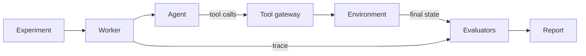

# AI Agent Eval

Runs an AI agent many times inside controlled environments, grades the resulting state, and compares configurations task by task.

Status: foundation only. The stack starts and reports health. Agents, environments and grading come next.

## How a run flows



Every agent changes state only through the tool gateway. Evaluators read the hidden expected state, which the agent never sees.

## Quick start

You need Docker and [uv](https://docs.astral.sh/uv/).

```bash
cp .env.example .env
make up
curl http://127.0.0.1:8000/health/ready
```

`make up` starts Postgres, runs migrations, then starts the API and the worker.

Demo mode with scripted agents and no provider key is not built yet.

## Make commands

| Command | What it does |
| --- | --- |
| `make up` | Build and start the stack, wait until healthy |
| `make down` | Stop the stack |
| `make logs` | Follow logs from every service |
| `make ps` | Show service status |
| `make migrate` | Run database migrations |
| `make db` | Start only Postgres, for running tests on the host |
| `make test` | Start Postgres, migrate, run the tests |
| `make lint` | Check lint and formatting |
| `make format` | Fix formatting and safe lint issues |
| `make typecheck` | Run mypy in strict mode on `app/` |
| `make check` | Lint, typecheck and test |

## Folders

| Folder | What it holds |
| --- | --- |
| `app/api/` | HTTP routes, including health checks |
| `app/db/` | Database engine and schema checks |
| `app/execution/` | The background worker |
| `migrations/` | Alembic migrations |
| `tests/` | Tests, laid out like `app/` |

## Settings

All settings are in `.env.example`. The main ones:

| Setting | Default | Meaning |
| --- | --- | --- |
| `DATABASE_URL` | local Postgres | Database for running outside Docker. Compose sets its own |
| `API_PORT` | `8000` | Host port for the API |
| `POSTGRES_PORT` | `5432` | Host port for Postgres |
| `LOG_LEVEL` | `INFO` | `DEBUG`, `INFO`, `WARNING` or `ERROR` |
| `LOG_FORMAT` | `json` | `json` or `text` |

## Connect your own agent

Not built yet. External agents will connect over HTTP and call the tool gateway with a short-lived run token. A minimal example agent will live in `examples/`.

## License

No license has been chosen yet. Until then, all rights are reserved.
