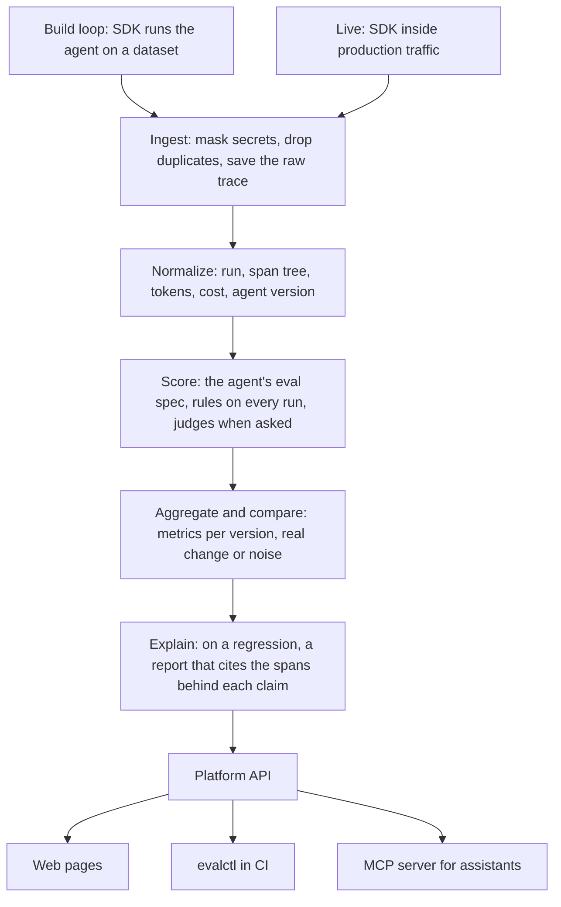

# AI Agent Eval

A platform that measures how well an AI agent works, while you build it and after it goes live. It grades every run from the agent's own trace, tracks results per agent version, and when a new version gets worse, it blocks the change and explains why.

## How it works

Every run of your agent becomes a trace: the model calls, tool calls and steps it took. The SDK sends traces from test runs and from production, and every trace takes the same path.



| Stage | What happens |
| --- | --- |
| Versions | The agent's config (model, prompt, tools, settings) is hashed. A new config is a new version, so results never mix across versions |
| Scoring | Each agent has a versioned eval spec. Rules are deterministic and run on every trace. Checklist and claim-check judges ask a Gemini model yes/no questions, must quote the run, and only count once people's labels agree with them |
| Comparing | Two experiments are paired case by case. Each metric (success rate, rule violations, consistency, run time, cost per success, runs scored) gets a 95% bootstrap interval, so noise is not read as a regression. The agent's gates turn that into ship, hold or can't tell |
| Explaining | Asked for on a comparison. It diffs the two configs, groups the new failures, and asks a model for a likely cause per group. A claim that does not cite real spans is dropped, and confidence is capped when the evidence is thin |
| Live traffic | Rules score every production trace. Health is kept per version and per day, and this week is compared with last week. Judging live runs happens only in batches you start or schedule |
| Workspaces | Teams work in separate workspaces with their own members, roles (owner, member, viewer), API tokens, Gemini keys and budgets. Every query is filtered by workspace |
| Money | Every model call reserves its worst-case cost against a budget first, so judges and reports can never overspend |
| Retention | An owner can set how many days run text is kept. Older inputs and outputs are removed; runs, costs and scores stay |

Every API route is described at `/docs` on a running server.

## Run it locally

You need Docker and [uv](https://docs.astral.sh/uv/).

### Try the demo, no key needed

The demo is a support agent for an online shop. Version 2 got a "refund straight away" prompt and started refunding before the customer's return arrived. The platform caught it, held the change and named the cause.

```bash
cp .env.example .env
echo "DEMO_MODE=true" >> .env
make up
make demo
```

Open http://127.0.0.1:8000 and press "Try the demo". It signs you in read-only.

| Where to look | What you see |
| --- | --- |
| Agents, then `support-agent` | v2 against v1: success rate down 22.5 points and marked real, the prompt sentence that changed, and the cause |
| See the comparison | The 5 cases that got worse, every metric with real or noise, and the full report with the spans it cites |
| Any failing run | The span tree: `issue_refund` called before `get_return`, and the rule that failed |
| Live traffic | Two weeks of production runs by day, and the alert raised after v2 shipped |

The runs are the agent's real recorded runs, scored and compared by the platform when you load them. Only the regression report is stored: it needs a model, so it was written by `gemini-3.5-flash` when the runs were recorded. The agent itself lives in its own repository, [ai-agent-eval-demo](https://github.com/VarshithaGudibandi/ai-agent-eval-demo), whose CI blocks the v2 pull request with this platform.

### Use it for your own agent

```bash
make up
curl -X POST http://127.0.0.1:8000/api/v1/auth/setup -H 'content-type: application/json' -d '{"email": "you@example.com", "password": "at least twelve characters", "workspace_name": "My team"}'
```

Setup works once and makes you the owner of the first workspace. Sign in at http://127.0.0.1:8000, then on Settings make an API token for your agent. To use judges or regression reports, set `APP_MASTER_KEY` in `.env` (the comment above it shows how to make one) and add a Gemini key on Settings. A free key is enough for experiments.

## Connect an agent

Install the SDK into your agent's environment. Its only dependency is `httpx`.

```bash
pip install ./sdk
export AGENT_EVAL_URL=http://127.0.0.1:8000 AGENT_EVAL_TOKEN=aet_...
```

### While you build: run an eval

`Eval` runs your agent on every case of a dataset, a few times each, and sends each run as a trace:

```python
from agent_eval import Eval

Eval(
    agent="support-bot",
    task=handle_request,  # called with each case's input
    dataset="cases.jsonl",
    config={"model": MODEL, "prompt": PROMPT, "tools": TOOLS},
    repetitions=3,
    scorers=[
        {
            "key": "refund_after_lookup",
            "check": "tool_order",
            "params": {"tool": "issue_refund", "after": ["get_order"]},
        },
    ],
)
```

A dataset file is JSON Lines, one case a line: `{"key": "refund-1", "input": {...}, "expected": {...}}`. Keep keys stable across versions so cases can be paired. At the end `Eval` prints how many runs passed, which scorers failed and a link. If the platform goes down mid-run, traces wait in `.agent_eval/pending/` and are sent later.

`examples/support_agent/` is a small LangGraph support agent wired up this way, with the shop's refund policy as rules over 8 cases.

| Check | Kind | Fails when |
| --- | --- | --- |
| `run_completed` | built-in | The run ended with an error |
| `tool_errors` | built-in | A tool call failed |
| `valid_tool_arguments` | built-in | A tool is not declared in the config, or its arguments break the schema |
| `turn_limit` | built-in | More model calls than `max_turns` (default 10) |
| `tool_order` | rule | `tool` is called before any of `after` finished |
| `tool_not_called` | rule | `tool` is called at all |
| `tool_call_limit` | rule | `tool` is called more than `max_calls` times |
| `reply_contains`, `reply_excludes` | rule | The final reply lacks, or contains, `text` |
| `matches_expected` | rule | `tool`'s `argument` differs from the case's expected `field` |
| `checklist` | judge | Trusted yes/no `questions` (or a `pack`: `support`, `tool_use`, `retrieval`) fall below the threshold |
| `claim_check` | judge | Too few of the reply's claims are backed by a tool result |

Checks are hard by default and judges soft. `applies_when` limits a scorer to runs with given `tags`, tools or an expected outcome.

### In CI: block regressions with evalctl

```bash
pip install ./cli
evalctl run eval.py
```

`evalctl run` runs the file's `Eval` and compares it with the newest experiment on the same dataset from the version marked shipped, or if none is marked, from another version. It exits `0` to ship, `1` to hold and `2` when it can't tell. A CI step on it fails the pull request on a regression. `--explain` adds the regression report. `--max-judge-calls N` caps judge spending. `evalctl compare` and `evalctl explain` work on experiments and comparisons that already ran.

### In production: trace live traffic

```python
from agent_eval import init, log_feedback, traced, wrap_gemini

init(
    agent="support-bot",
    config={"model": MODEL, "prompt": PROMPT, "tools": TOOLS},
    environment="production",
)
client = wrap_gemini(genai.Client())  # records every model call


@traced
def get_order(order_id): ...  # a tool, because it runs inside a trace


@traced
def handle_request(message): ...  # each call is one trace


log_feedback(trace_id, 0, "Refunded the wrong order")  # 1 is thumbs up
```

Traces are sent from a background thread through a bounded queue. If the platform is down they are dropped, and the SDK never raises into your code. Secrets are masked before anything leaves the process; pass `redact=` to `init` to remove personal data too.

### From another language: post traces

```bash
curl -X POST http://127.0.0.1:8000/api/v1/traces -H "authorization: Bearer $TOKEN" -H 'content-type: application/json' -d '{"traces": [...]}'
```

```json
{
  "trace_id": "run-0001",
  "agent": "support-bot",
  "config": {"model": "gemini-3.5-flash-lite", "prompt": "You are a support agent.", "tools": []},
  "tags": {"environment": "production"},
  "spans": [
    {"id": "root", "kind": "step", "name": "handle_request", "start": "2026-11-12T10:00:00Z", "end": "2026-11-12T10:00:02Z", "input": {"message": "Where is my order?"}, "output": {"reply": "It shipped."}},
    {"id": "m1", "parent_id": "root", "kind": "model", "name": "answer", "start": "2026-11-12T10:00:00Z", "end": "2026-11-12T10:00:01Z", "provider": "gemini", "model": "gemini-3.5-flash-lite", "input_tokens": 900, "output_tokens": 40}
  ]
}
```

One root span; every other span names its parent. `kind` is `model`, `tool` or `step`. Sending the same `trace_id` twice stores it once. The response lists accepted, duplicate and rejected traces with reasons.

### From your assistant: ask over MCP

`agent-eval-mcp` lets an assistant such as Claude Code ask about your agents. It runs on your machine and only uses the token you give it.

```bash
pip install ./sdk ./mcp
claude mcp add --env AGENT_EVAL_URL=http://127.0.0.1:8000 --env AGENT_EVAL_TOKEN=aet_... --transport stdio agent-eval -- agent-eval-mcp
```

| Tool | Answers |
| --- | --- |
| `list_agents` | Your agents, their newest and shipped versions |
| `agent_health` | The metrics for the newest experiment against its baseline, or this week's live runs against last week's |
| `show_failing_runs` | How the newest runs failed, by reason, with example runs |
| `compare_versions` | "Did my last change break anything?": ship or hold, why, the metrics and the cases that got worse |
| `explain_regression` | The regression report for that comparison. Needs a member token and a Gemini key |

It only reads results. To measure a change, run `evalctl run eval.py` first, then ask. Answers carry numbers and links, never what your agent's users wrote.

## Make commands

| Command | What it does |
| --- | --- |
| `make up` | Build and start Postgres, migrations, the API and the worker |
| `make demo` | Load the demo workspace into the running stack. Running it again changes nothing |
| `make up-hosted` | Start on a server: HTTPS for `DOMAIN` through Caddy, with Postgres and the API reachable only inside |
| `make down` | Stop the stack |
| `make logs` | Follow logs from every service |
| `make ps` | Show service status |
| `make migrate` | Run database migrations |
| `make test` | Run the tests on a separate test database. No network or key needed |
| `make test-paid` | Run the tests that call the real Gemini API. Needs `GEMINI_API_KEY` |
| `make lint` | Check lint and formatting |
| `make format` | Fix formatting and safe lint issues |
| `make typecheck` | Run mypy in strict mode |
| `make check` | Lint, typecheck and test |

## Folders

| Folder | What it holds |
| --- | --- |
| `app/api/` | HTTP routes |
| `app/auth/` | Accounts, sessions, invites and API tokens |
| `app/budget/` | Prices, cost estimates and budget reservations |
| `app/db/` | Tables, the workspace-scoped data layer, the job queue, retention |
| `app/demo/` | The demo's recorded data and the command that loads it |
| `app/explain/` | The regression explainer |
| `app/ingest/` | The trace format, secret masking and storing raw traces |
| `app/jobs/` | The worker |
| `app/metrics/` | Health metrics, comparisons, bootstrap intervals and gates |
| `app/providers/` | The Gemini provider, encrypted keys, rate limiting, metered calls |
| `app/scoring/` | Eval specs, checks, rules, judges and verdicts |
| `app/traces/` | Turning a trace into a run, spans, cost and an agent version |
| `app/web/` | Web pages, templates and static files |
| `sdk/` | The `agent_eval` package agents use to send traces |
| `cli/` | `evalctl` for terminals and CI |
| `mcp/` | `agent-eval-mcp` for assistants |
| `examples/` | A small example agent and dataset |
| `migrations/` | Database migrations |
| `tests/` | Tests, laid out like the folders above |

## Settings

Every setting is listed with a comment in `.env.example`. The ones you are most likely to change:

| Setting | Default | Meaning |
| --- | --- | --- |
| `APP_MASTER_KEY` | none | Encrypts stored Gemini keys. Needed for judges and reports |
| `DEMO_MODE` | `false` | Show "Try the demo" on the sign-in page |
| `DOMAIN` | none | For `make up-hosted`: the domain pointing at the server |
| `POSTGRES_PASSWORD` | `agent_eval` | Change it on any server |
| `SESSION_COOKIE_SECURE` | `false` | Send cookies over HTTPS only. The hosted profile turns it on |
| `EXPLAINER_MODEL` | `gemini-3.5-flash` | Model that writes regression reports |
| `API_PORT` | `8000` | Host port for the API |
| `WORKER_CONCURRENCY` | `2` | Jobs one worker runs at once |
| `INGEST_TRACES_PER_MINUTE` | `1200` | Traces one workspace may send per minute |
| `LOG_LEVEL` | `INFO` | `DEBUG`, `INFO`, `WARNING` or `ERROR` |

## License

No license has been chosen yet. Until then, all rights are reserved.
